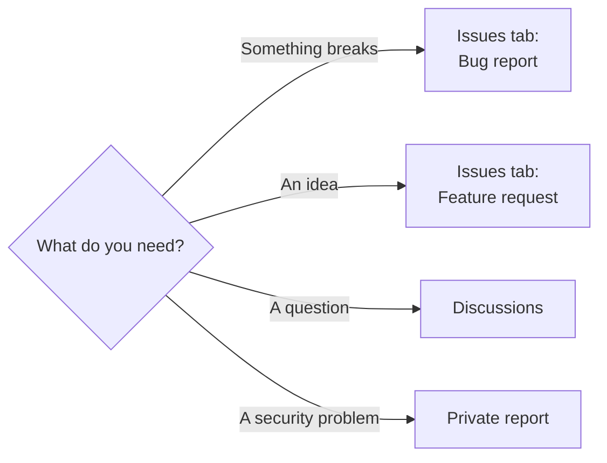

# Support

| Need | Where |
| --- | --- |
| Report a bug | The Issues tab, **New issue**, the **Bug Report** form |
| Propose a feature | The Issues tab, the **Feature Request** form |
| Ask how it works | [Discussions](https://github.com/Soul-Craft/buddy-evolver/discussions), or the [README](README.md) |
| Report a security problem | [SECURITY.md](SECURITY.md), never a public issue |
| Report conduct | [CODE_OF_CONDUCT.md](CODE_OF_CONDUCT.md) |
| Contribute a change | [CONTRIBUTING.md](CONTRIBUTING.md) |
