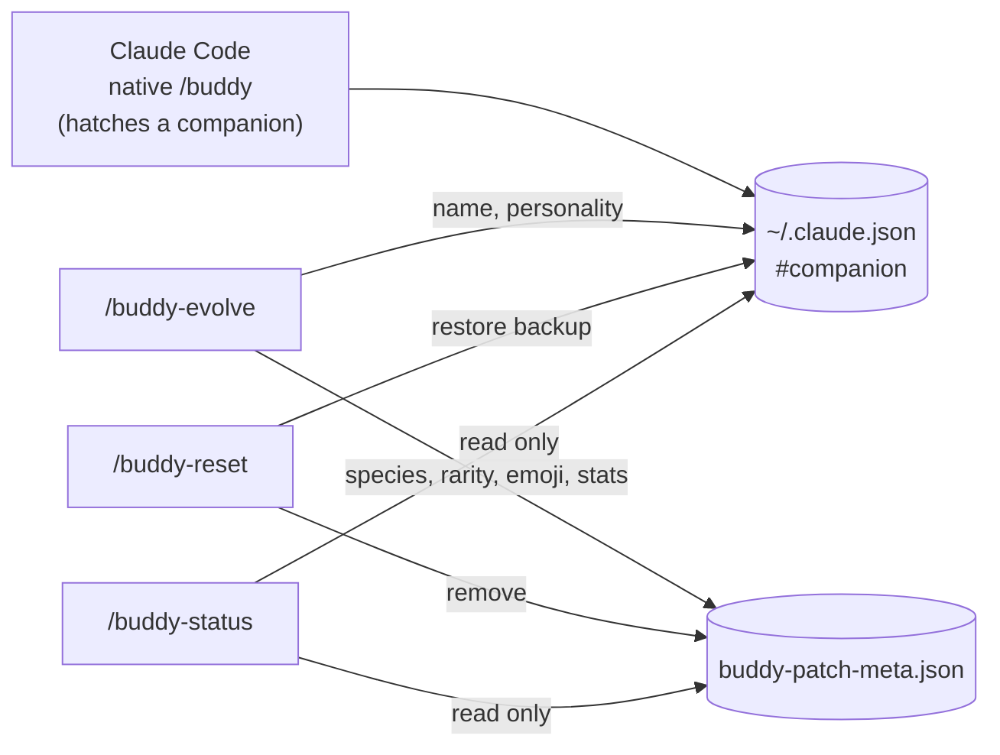

# Spec: keep Buddy Evolver working beside Claude Code's `/buddy`

The owner chose this direction on 2026-11-25: keep the plugin working, and do not grow it. Issue [#52](https://github.com/Soul-Craft/buddy-evolver/issues/52) tracks this document.

## The three commands

| Command | Writes | Reaches Claude Code | Must keep working |
| --- | --- | --- | --- |
| `/buddy-evolve` | name and personality to `~/.claude.json#companion`, card metadata to `~/.claude/backups/buddy-patch-meta.json` | name and personality only | the write is atomic. A backup exists first. The card shows the new buddy |
| `/buddy-reset` | restores the soul backup, removes the metadata | yes | the original companion returns, and it does nothing when no backup exists |
| `/buddy-status` | nothing | no | the card renders from both files, and a missing file shows a plain message |

## Goals and non-goals

| In scope | Out of scope |
| --- | --- |
| Name and personality still reach Claude Code's own companion | New species, rarity tiers or stats |
| The plugin never registers a skill named `buddy`, so it never shadows the native command | Any binary patching. Version 2.0.0 retired it |
| The unreleased fixes ship as version 2.0.1 | Support for platforms other than macOS |
| Issue [#10](https://github.com/Soul-Craft/buddy-evolver/issues/10) is closed with a pointer, since it predates 2.0.0 | A second companion feature |

## Checks

| Check | Where it runs | Status | Tracked in |
| --- | --- | --- | --- |
| `/buddy` guard: no skill named `buddy` | `scripts/test-docs.sh`, group 10 | in CI on a Mac and on Linux | built in |
| Docs and architecture agree | `scripts/test-docs.sh` and `doc-sync` in `ci-quality.yml` | passes on Linux | built in |
| Name and personality reach the native companion | a Mac session with Claude Code | not run yet | [#53](https://github.com/Soul-Craft/buddy-evolver/issues/53) |
| Six test tiers | `bash scripts/test-all.sh` on a Mac | pending a Mac session | each pull request |
| CodeQL default setup | repository settings, from a Mac session | not configured | [#51](https://github.com/Soul-Craft/buddy-evolver/issues/51) |

## Work queue

| Step | Issue | Where it runs |
| --- | --- | --- |
| Agent files, spec, Quality and Process pages | [#52](https://github.com/Soul-Craft/buddy-evolver/issues/52) | cloud |
| Compatibility check with native `/buddy` | [#53](https://github.com/Soul-Craft/buddy-evolver/issues/53) | Mac |
| Release 2.0.1 | [#54](https://github.com/Soul-Craft/buddy-evolver/issues/54) | Mac, after #53 |
| Pages on | [#55](https://github.com/Soul-Craft/buddy-evolver/issues/55) | Mac |
| Ruleset on `main` | [#56](https://github.com/Soul-Craft/buddy-evolver/issues/56) | Mac |
| Pin Actions to SHAs | [#57](https://github.com/Soul-Craft/buddy-evolver/issues/57) | cloud |
| Project board and cards | [#58](https://github.com/Soul-Craft/buddy-evolver/issues/58) | Mac |

## Release 2.0.1

| Item | Detail |
| --- | --- |
| Contents | the `[Unreleased]` section of `CHANGELOG.md`: the retired `/buddy` registration, the regression guard, and the stale-reference fixes |
| Gate | a fresh review and green macOS tests, then `/session-deploy --release` |
| Who | Claude. The owner delegated releases on 2026-11-25 |
